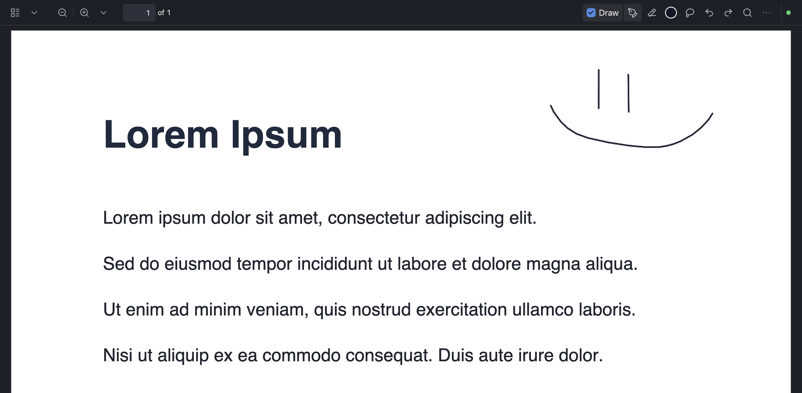

# Welcome to Handwriting Natively!

## What Handwriting Natively Does

Handwrite on PDFs, supported static PNG/JPEG images, and Markdown Reading or editing views in Obsidian. Confirmed stylus input annotates by default; mouse annotation and finger drawing are separate opt-in settings. Committed text boxes retain touch editing when touch drawing is off, and a completed one-finger double-tap can switch between the eraser and the previous tool. On compatibility-checked iOS, iPadOS, and Android PDF pages, one finger pans and two fingers pinch; unsupported and unsafe surfaces keep native viewer gestures. Markdown ink and text annotations use the same floating toolbar, tools, undo/redo, and vault sidecars as PDF and image annotations. Source and Live Preview keep native typing, selection, and scrolling. Explicit page insert/delete/import/scan actions update the open PDF and remap its sidecar atomically. Export PDFs as flattened or editable copies, or export an annotated image as a bounded flattened copy in its source PNG/JPEG format. Text boxes are sidecar-backed and editable in Text mode; physical eraser tips and optional whole-stroke erasing are supported.

I made this plugin after realizing I use Obsidian a lot more than another nameless note taking app.. I hope you find it as useful as I do!

- Pen, graphite pencil, highlighter, laser pointer, eraser, and lasso tools in a movable toolbar
- Stylus annotation by default, with optional mouse/touch drawing and compatibility-checked mobile PDF pan/pinch
- Autosaving, everyones favorite feature
- Commands to create a GoodNotes-inspired blank PDF notebook and hotkeys for tools, undo, and redo

## Setup

### Quick Start

1. Look in Obsidian Plugins.
2. Look up Handwriting Natively.
3. Install and open a supported PDF, image, or Markdown file.

### Manual Setup

1. Install the BRAT plugin.
2. Open BRAT and paste in https://github.com/MarsLuay/handwriting-natively.
3. Select a release (the latest pre-release is my pick), install it, then open a supported PDF, image, or Markdown file.

### PDF viewer ownership

Direct PDF leaves use the plugin-owned public `ItemView`. PDF.js remains the parser, text, annotation, and raster-rendering engine, while the plugin owns the page shells, scroll/zoom state, and same-DOM handwriting overlays. The shared toolbar provides page navigation, page-number entry, zoom presets, fit-width, rotation, outline and thumbnail sidebars, document search, stylus hand-pan, presentation mode, print, and download. Embedded PDFs remain in their host-owned viewer. The pinned PDF.js and pdf-lib runtimes are bundled into `main.js`, keeping BRAT installs self-contained because BRAT installs only the three standard plugin assets; no CDN or Obsidian private viewer DOM is required. If the bundled runtime cannot load, the direct view fails closed and offers the native Obsidian PDF viewer as a reversible fallback.

## If you want..

If you like what I've made, I would deeply appreciate a donation to my https://buymeacoffee.com/marwanluaye! I need to support a coffee addiction but have to spend my spare money on silly things like a college education

## License

MIT — see [LICENSE](LICENSE).

If this project is used for any others, all that is required is acknowledging this repo and me. Thank you! Build cool things

## Privacy

Local-only annotation processing. See [PRIVACY.md](PRIVACY.md) and [TERMS.md](TERMS.md). No online telemetry or hosted service.
